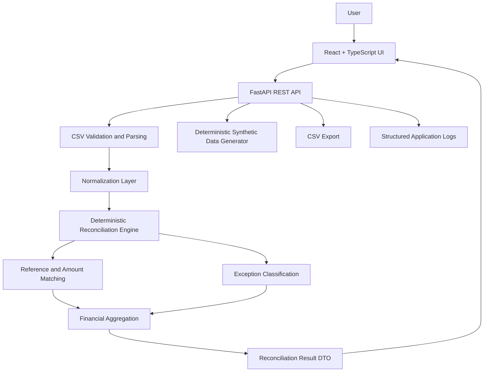
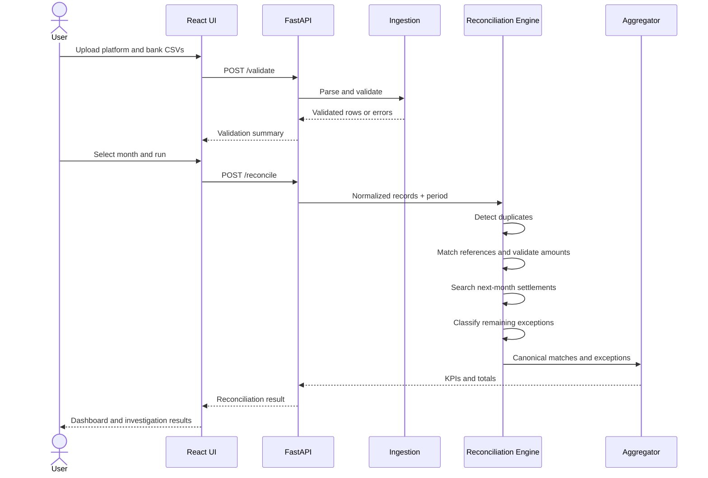

# SmartPay Reconciliation — System Architecture

**Version:** 1.0

## 1. Architecture principles

1. Correctness before visual polish.
2. Deterministic reconciliation rules; no LLM makes financial matching decisions.
3. Traceability from every result back to input rows.
4. Separate ingestion, normalization, matching, classification, aggregation, and presentation.
5. Keep the assessment implementation simple enough to build and explain within the time limit.

## 2. Recommended architecture



## 3. Suggested repository structure

```text
smartpay-reconciliation/
├── frontend/
│   ├── src/
│   │   ├── components/
│   │   ├── pages/
│   │   ├── api/
│   │   ├── types/
│   │   └── utils/
│   ├── package.json
│   └── vite.config.ts
├── backend/
│   ├── app/
│   │   ├── main.py
│   │   ├── api/
│   │   │   ├── routes.py
│   │   │   └── schemas.py
│   │   ├── services/
│   │   │   ├── ingestion.py
│   │   │   ├── normalization.py
│   │   │   ├── reconciliation.py
│   │   │   ├── classification.py
│   │   │   ├── aggregation.py
│   │   │   └── export.py
│   │   ├── models/
│   │   └── data_generator.py
│   ├── tests/
│   └── requirements.txt
├── sample_data/
│   ├── platform_transactions.csv
│   └── bank_settlements.csv
├── docs/
├── README.md
└── .gitignore
```

This is a suggested structure, not a requirement to create unnecessary abstractions. Keep the code small and coherent.

## 4. Component responsibilities

### Frontend
- Upload files and display validation feedback.
- Select reporting month.
- Trigger reconciliation.
- Render dashboard KPIs, charts, transaction table, and exception details.
- Download CSV exports.
- Never calculate authoritative reconciliation outcomes itself.

### FastAPI API
- Validate request and uploaded files.
- Call the ingestion and reconciliation services.
- Return typed, documented response objects.
- Provide sample data and export endpoints.
- Handle errors consistently.

### Ingestion and normalization
- Parse CSV rows.
- Validate schema and required values.
- Normalize IDs and enum values without altering original values.
- Parse dates using a documented timezone policy.
- Parse amounts with `Decimal`.
- Preserve source filename, source row number, and original row payload.

### Reconciliation engine
- Identify duplicate rows before canonical matching.
- Match by stable references.
- Validate currency, transaction type, amount, and dates.
- Search the next month for late settlements.
- Classify exceptions with explicit reason codes.
- Produce evidence-linked results.

### Aggregation
- Calculate totals from canonical records, not raw duplicated rows.
- Keep gross payment, refund, fee, and net settlement semantics distinct.
- Calculate aggregate rounding variance only across comparable populations.
- Expose formulas and included/excluded rows.

## 5. Suggested API endpoints

| Method | Endpoint | Purpose |
|---|---|---|
| GET | `/health` | Health check |
| GET | `/api/v1/sample-data` | Generate or retrieve sample data |
| POST | `/api/v1/validate` | Validate uploaded CSV files |
| POST | `/api/v1/reconcile` | Run reconciliation for a reporting month |
| GET | `/api/v1/reconciliations/{run_id}` | Retrieve a run result if persistence is implemented |
| GET | `/api/v1/reconciliations/{run_id}/export` | Export full result CSV |
| GET | `/api/v1/reconciliations/{run_id}/exceptions` | Export or retrieve exception details |

If persistence is not implemented, use a clear in-memory run store for the demo and document that limitation. Do not pretend it survives restarts.

## 6. Reconciliation flow



## 7. Result data model

A reconciliation result should include:
- `run_id`
- `reporting_period`
- `generated_at`
- `source_counts`
- `summary`
- `matches[]`
- `exceptions[]`
- `assumptions[]`
- `warnings[]`

Each match or exception should retain:
- stable result ID
- status / reason code
- platform record reference, if any
- bank record reference, if any
- platform amount and currency, if any
- bank amount and currency, if any
- transaction date and settlement date, if any
- financial impact
- explanatory message
- source filename and row number(s)

## 8. Security and reliability baseline

- Restrict upload size and accepted file types.
- Validate all columns and values server-side.
- Do not execute uploaded content.
- Do not log full financial records or personal data.
- Use environment variables for deployment configuration.
- Configure CORS narrowly for the deployed frontend.
- Use HTTPS in deployment.
- Never include secrets in the repository.
- Make each reconciliation run reproducible from its input files and rule configuration.
